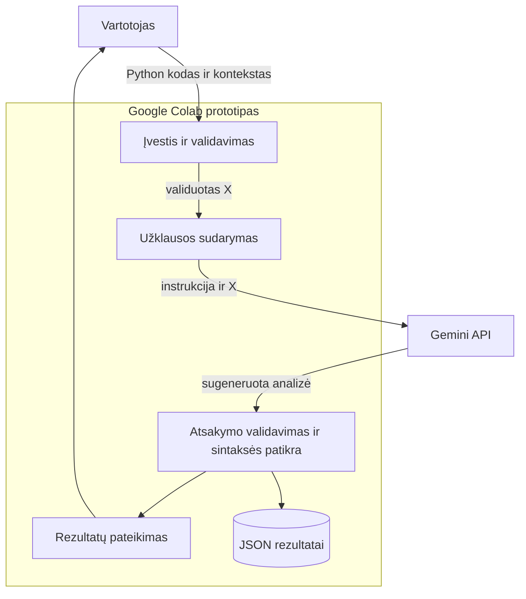

# DI pagrįsta programavimo klaidų analizės sistema
**1 namų darbas · Liutauras Turauskis · DIPf-24**
## ND1 užduotys 1.3–1.5

Visos 1.3–1.5 užduotys sujungtos į **[vieną Colab užrašyną](https://colab.research.google.com/github/Laran20/DI-pagrista-programavimo-klaidu-analizes-sistema/blob/main/ND1_1_3_1_5/ND1_1_3_1_5.ipynb)**: NN, Decision Forests, CNN ir perkėlimo mokymasis. [Aprašymas ir paleidimas](ND1_1_3_1_5/README.md).

Gemini API rakto nereikia. Sujungto failo sintaksė ir priklausomybės patikrintos; visas mokymas ir išvestys dar turi būti patikrinti Colab.


[](https://colab.research.google.com/github/Laran20/DI-pagrista-programavimo-klaidu-analizes-sistema/blob/main/ND1_DI_programavimo_klaidu_analize.ipynb)

Prototipas demonstruoja Python programavimo klaidų analizę su trimis iš anksto parengtais pavyzdžiais. Pagal kodą, norimą elgesį ir klaidos pranešimą Gemini sugeneruoja klaidos paaiškinimą, pataisytą kodą, testavimo pavyzdžius ir prevencijos patarimą.

## Paleidimas Google Colab
1. Spausk **Atidaryti Google Colab** mygtuką aukščiau. Atsidarys šios saugyklos `ND1_DI_programavimo_klaidu_analize.ipynb` užrašynas.
2. [Google AI Studio](https://aistudio.google.com/apikey) susikurk API raktą. Colab kairėje **Secrets** sukurk `GOOGLE_API_KEY` ir įjunk **Notebook access**. Rakto į GitHub nekelk.
3. Pasirink **Runtime → Run all**. GPU nereikia. Pavyzdžiai ir instrukcija yra užrašyne, papildomų failų įkelti nereikia.
4. 7 žingsnyje turi pasirodyti **3/3** tikrų atsakymų; peržiūrėk pataisytą kodą, testus ir suvestinę. Jei modelis nepasiekiamas, pakeisk `MODEL` į paskyroje pasiekiamą tekstinį Gemini modelį. Kvotos klaidos atveju patikrink AI Studio kvotą ir pakartok vėliau.

**Patikrinta versija (2026-10-14):** Colab aplinkoje su `gemini-3.5-flash-lite` gauti 3/3 tikri Gemini atsakymai. Visos klaidų klasės sutapo su etalonais, sintaksės patikros praėjo. Po kodo peržiūros lokaliai atliktos 7 nepriklausomos funkcijų patikros – visos sėkmingos. Užrašyne išsaugotos tikros analizės išvestys; rezultatai pateikti [outputs/](outputs/).


## Struktūra
```text
ND1_DI_programavimo_klaidu_analize.ipynb
data/
  examples.json
  01_sintakses_klaida/  (X_input.json, y_expected.json, buggy.py, reference_fixed.py)
  02_vykdymo_klaida/    (tie patys failai)
  03_logine_klaida/     (tie patys failai)
prompts/
  design_prompt.txt
  system_prompt.txt
  test_prompt.txt
diagrams/
  components.puml, activity.puml
  components.mmd, activity.mmd, README.md
  components.png, activity.png
outputs/
  01_sintakses_klaida.json
  02_vykdymo_klaida.json
  03_logine_klaida.json
  summary.csv, verification.json
requirements.txt
```

## Trys End-to-End pavyzdžiai
| X | Tikėtinas y | Modelio rezultatas ŷ |
|---|---|---|
| `suma`: po def nėra dvitaškio | Sintaksės klaida; pridėti `:` | Gautas; klasė ir sintaksė teisingos |
| `vidurkis([])`: dalyba iš nulio | Vykdymo klaida; tuščiam sąrašui None | Gautas; klasė ir sintaksė teisingos |
| Kaina su 20 % nuolaida grąžina 20 vietoje 80 | Loginė klaida; atimti nuolaidą | Gautas; klasė ir sintaksė teisingos |

Modeliui siunčiamas tik X. y naudojamas palyginimui po atsakymo. Generatyvinis DI papildomai neapmokomas. `prompts/test_prompt.txt` galima tiesiog nukopijuoti GPT agentui. Projektavimo užklausa ir PlantUML → Mermaid rezultatai yra `prompts/design_prompt.txt` bei [diagrams/README.md](diagrams/README.md).

## Sistemos sandara



## Vertinimas ir ribos
Tikrinama atsakymo struktūra, pataisyto kodo sintaksė ir klaidos klasės atitiktis y; matuojama užklausos trukmė. Semantinis kodo teisingumas automatiškai neįrodomas: parengti nepriklausomi testai `checks`, tačiau modelio kodas automatiškai nevykdomas. Trys mokomieji pavyzdžiai nėra bendro sistemos tikslumo įvertis.

## Šaltiniai
- [Oficialus Google Gen AI Python SDK](https://github.com/googleapis/python-genai)
- [Gemini API dokumentacija](https://ai.google.dev/gemini-api/docs)
- Dėstytojo pateikti du demonstraciniai užrašynai; darbo eiga pritaikyta Python klaidų analizei.

## Patikrinti rezultatai

| Pavyzdys | Modelio klasė | Klasė ir sintaksė | Užklausos trukmė | Nepriklausomos patikros |
|---|---|---|---|---|
| suma | sintakses | teisingos | 12,624 s | 2/2 |
| vidurkis | vykdymo | teisingos | 1,519 s | 2/2 |
| kaina_po_nuolaidos | logine | teisingos | 26,139 s | 3/3 |

Patikrintas dviejų skaičių sumavimas, įprasto ir tuščio sąrašo vidurkis bei 20 %, 0 % ir 100 % nuolaidos. Rezultatai: [summary.csv](outputs/summary.csv), [funkcijų patikrų duomenys](outputs/verification.json). JSON atsakymai eksportuoti iš užrašyne išsaugotų tikrų Gemini išvesčių; tai nėra naujas API paleidimas. Modelio siūlomi testai yra rekomendacijos; 7 nepriklausomos patikros atliktos atskirai peržiūrėtam kodui.

Paleidus užrašyną iš naujo reikia savo API rakto. API modelio prieiga, apkrova ir projekto kvota gali kisti; išsaugotas sėkmingas paleidimas negarantuoja, kad kiekviena būsima užklausa pavyks.
