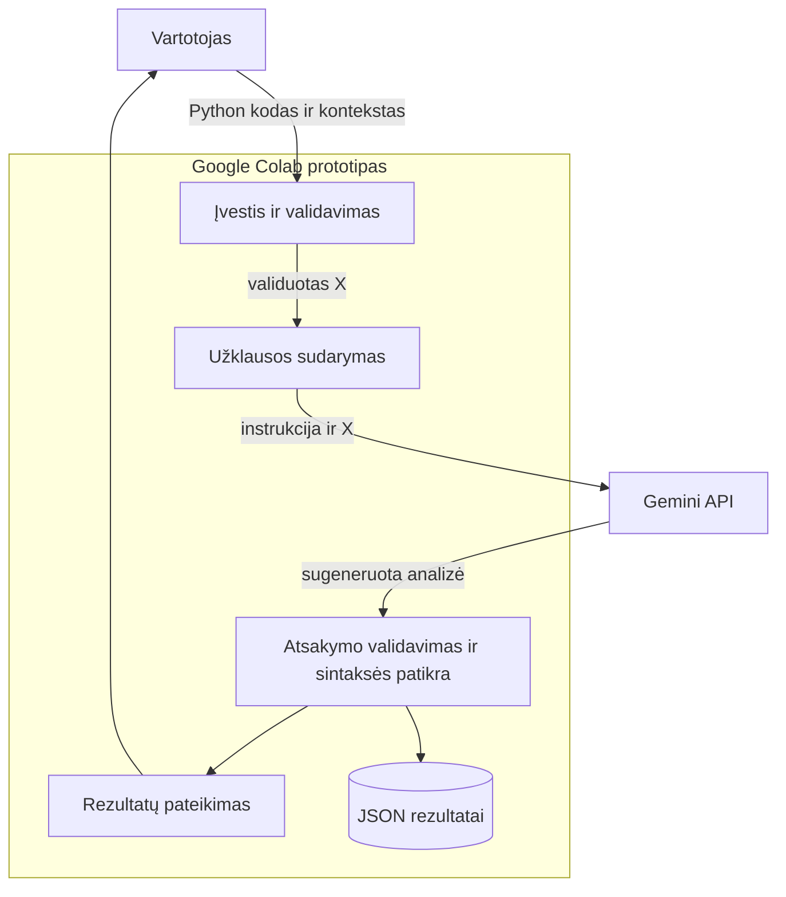

# DI pagrįsta programavimo klaidų analizės sistema
**1 namų darbas · Liutauras Turauskis · DIPf-24**

[](https://colab.research.google.com/github/Laran20/DI-pagrista-programavimo-klaidu-analizes-sistema/blob/main/ND1_DI_programavimo_klaidu_analize.ipynb)

Sistema skirta pradedančiajam programuotojui: pagal Python kodą, norimą elgesį ir klaidos pranešimą Gemini sugeneruoja klaidos paaiškinimą, pataisytą kodą, testavimo pavyzdžius ir prevencijos patarimą.

## Paleidimas Google Colab
1. Spausk **Atidaryti Google Colab** mygtuką aukščiau. Atsidarys šios saugyklos `ND1_DI_programavimo_klaidu_analize.ipynb` užrašynas.
2. [Google AI Studio](https://aistudio.google.com/apikey) susikurk API raktą. Colab kairėje **Secrets** sukurk `GOOGLE_API_KEY` ir įjunk **Notebook access**. Rakto į GitHub nekelk.
3. Pasirink **Runtime → Run all**. GPU nereikia. Pavyzdžiai ir instrukcija yra užrašyne, papildomų failų įkelti nereikia.
4. 7 žingsnyje turi pasirodyti **3/3** tikrų atsakymų; peržiūrėk pataisytą kodą, testus ir suvestinę. Jei modelis nepasiekiamas, pakeisk `MODEL` į paskyroje pasiekiamą tekstinį Gemini modelį. Kvotos klaidos atveju patikrink AI Studio kvotą ir pakartok vėliau.
5. Atsisiųsk rezultatų ZIP ir išarchyvuok jo `outputs/` į saugyklą. Vykdytą `.ipynb` išsaugok per **File → Download → Download .ipynb** arba **Save a copy in GitHub**.

**Pateikto paketo būsena:** paruošta paleisti; tikra Gemini API užklausa rengiant paketą neatlikta, nes nepateiktas API raktas. Ranka parengti y etalonai nėra Gemini atsakymai. Galutiniam atsiskaitymui reikia įkelti vykdytą užrašyną su tikrais atsakymais.

## Struktūra
```text
ND1_DI_programavimo_klaidu_analize.ipynb
data/
  examples.json
  01_sintakses_klaida/  (X_input.json, y_expected.json, buggy.py, reference_fixed.py)
  02_vykdymo_klaida/    (tie patys failai)
  03_logine_klaida/     (tie patys failai)
prompts/
  design_prompt.txt
  system_prompt.txt
  test_prompt.txt
diagrams/
  components.puml, activity.puml
  components.mmd, activity.mmd, README.md
GITHUB_IR_COLAB.md
GYNIMAS.md
requirements.txt
```

## Trys End-to-End pavyzdžiai
| X | Tikėtinas y | Modelio rezultatas ŷ |
|---|---|---|
| `suma`: po def nėra dvitaškio | Sintaksės klaida; pridėti `:` | Sugeneruojamas paleidus užrašyną |
| `vidurkis([])`: dalyba iš nulio | Vykdymo klaida; tuščiam sąrašui None | Sugeneruojamas paleidus užrašyną |
| Kaina su 20 % nuolaida grąžina 20 vietoje 80 | Loginė klaida; atimti nuolaidą | Sugeneruojamas paleidus užrašyną |

Modeliui siunčiamas tik X. y naudojamas palyginimui po atsakymo. Generatyvinis DI papildomai neapmokomas. `prompts/test_prompt.txt` galima tiesiog nukopijuoti GPT agentui. Projektavimo užklausa ir PlantUML → Mermaid rezultatai yra `prompts/design_prompt.txt` bei [diagrams/README.md](diagrams/README.md).

## Sistemos sandara



## Vertinimas ir ribos
Tikrinama atsakymo struktūra, pataisyto kodo sintaksė ir klaidos klasės atitiktis y; matuojama užklausos trukmė. Semantinis kodo teisingumas automatiškai neįrodomas: parengti nepriklausomi testai `checks`, tačiau modelio kodas automatiškai nevykdomas. Trys mokomieji pavyzdžiai nėra bendro sistemos tikslumo įvertis.

## Atitiktis užduočiai
| Reikalavimas | Kur įgyvendinta |
|---|---|
| 1.1 Tema ir generatyvinį DI naudojanti sistema | README ir užrašyno pradžia; Gemini API |
| 1.1 Promptas, PlantUML, po to Mermaid | prompts/design_prompt.txt; diagrams/; užrašyno 1 skyrius |
| 1.2.1 Bent 3 (X,y) poros | data/ ir užrašyno 4 žingsnis |
| 1.2.1 Testavimo promptas | prompts/test_prompt.txt |
| 1.2.2 Colab, Gemini, pavadinimas, apžvalga ir kodo paaiškinimas | .ipynb Markdown ir komentarai tarp kodo dalių |
| 1.2.2 Visa veikimo eiga ir vizualizavimas | Užrašyno 7–8 žingsniai; vykdyti su savo API raktu |
| .ipynb GitHub saugykloje | Užrašynas šios saugyklos šaknyje; po Colab paleidimo atnaujinti versiją su tikrais rezultatais |

## Šaltiniai
- [Oficialus Google Gen AI Python SDK](https://github.com/googleapis/python-genai)
- [Gemini API dokumentacija](https://ai.google.dev/gemini-api/docs)
- Dėstytojo pateikti du demonstraciniai užrašynai; darbo eiga pritaikyta Python klaidų analizei.
