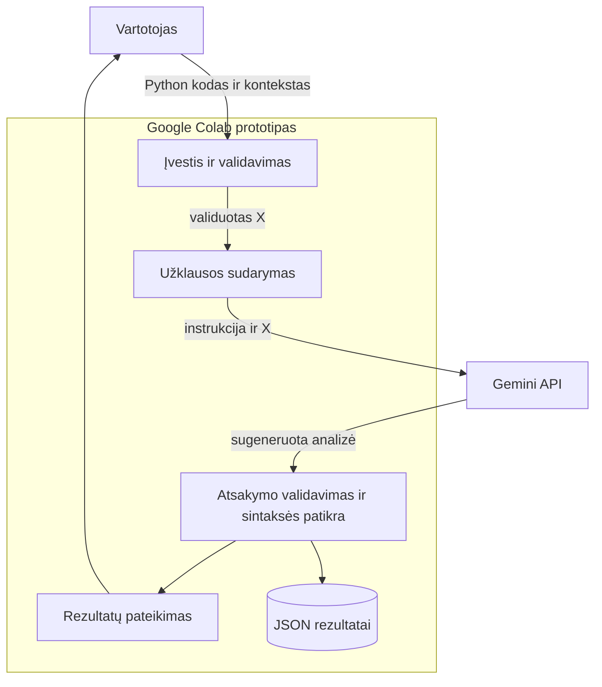

# DI pagrįsta programavimo klaidų analizės sistema
**1 namų darbas · Liutauras Turauskis · DIPf-24**

[](https://colab.research.google.com/github/Laran20/DI-pagrista-programavimo-klaidu-analizes-sistema/blob/main/ND1_DI_programavimo_klaidu_analize.ipynb)

Sistema skirta pradedančiajam programuotojui: pagal Python kodą, norimą elgesį ir klaidos pranešimą Gemini sugeneruoja klaidos paaiškinimą, pataisytą kodą, testavimo pavyzdžius ir prevencijos patarimą.

## Paleidimas Google Colab
1. Spausk **Atidaryti Google Colab** mygtuką aukščiau. Atsidarys šios saugyklos `ND1_DI_programavimo_klaidu_analize.ipynb` užrašynas.
2. [Google AI Studio](https://aistudio.google.com/apikey) susikurk API raktą. Colab kairėje **Secrets** sukurk `GOOGLE_API_KEY` ir įjunk **Notebook access**. Rakto į GitHub nekelk.
3. Pasirink **Runtime → Run all**. GPU nereikia. Pavyzdžiai ir instrukcija yra užrašyne, papildomų failų įkelti nereikia.
4. 7 žingsnyje turi pasirodyti **3/3** tikrų atsakymų; peržiūrėk pataisytą kodą, testus ir suvestinę. Jei modelis nepasiekiamas, pakeisk `MODEL` į paskyroje pasiekiamą tekstinį Gemini modelį. Kvotos klaidos atveju patikrink AI Studio kvotą ir pakartok vėliau.
5. Savo kodui analizuoti 9 žingsnyje pakeisk `custom_x` laukus ir nustatyk `RUN_CUSTOM = True`.

**Patikrinta versija (2026-10-14):** Colab aplinkoje su `gemini-3.5-flash-lite` gauti 3/3 tikri Gemini atsakymai. Visos klaidų klasės sutapo su etalonais, sintaksės patikros praėjo. Po kodo peržiūros lokaliai atliktos 7 nepriklausomos funkcijų patikros – visos sėkmingos. Užrašyne išsaugotos tikros analizės išvestys; rezultatai pateikti [outputs/](outputs/).


## Kaip patikrinti savo kodą

### Ko reikia

- Google paskyros, Google Colab ir savo Gemini API rakto su prieiga prie pasirinkto modelio bei laisva kvota.
- Python kodo fragmento, kurį nori analizuoti.
- Aiškaus aprašymo, ką kodas turi atlikti. Jei yra klaidos pranešimas, pateik jį kartu su aplinkybėmis, kada jis atsiranda.
- GPU ar vietinio Python diegimo nereikia, jei dirbi Colab.

### Įvesties reikalavimai

| Laukas | Ką įrašyti | Ar būtinas? |
|---|---|---|
| `language` | `"Python"` | Taip; ši versija priima tik Python |
| `description` | Pageidaujamas elgesys, pavyzdinė įvestis ir laukiamas rezultatas | Taip; negali būti tuščias |
| `code` | Tikras kodo tekstas su išlaikytomis eilutėmis ir įtraukomis | Taip; negali būti tuščias |
| `error_message` | Klaidos tekstas arba neteisingo rezultato aprašymas | Laukas būtinas; jei klaidos teksto nėra, galima `""` |

Visa įvestis po JSON užkodavimo turi neviršyti **30 000 simbolių**. Tai bendra visų keturių laukų riba, o ne vien kodo ilgis. Rekomenduojama pateikti trumpą savarankišką funkciją ir jai suprasti būtiną kontekstą.

Jei programa nesukelia išimties, bet grąžina neteisingą rezultatą, aprašyk, **ką gauni ir ką turėtum gauti**. Pavyzdžiui: „Kai kaina=100 ir nuolaida=20, gaunu 20, bet turėtų būti 80“.

### Paleidimas

1. Atidaryk užrašyną per **Atidaryti Google Colab** mygtuką.
2. Colab **Secrets** sukurk `GOOGLE_API_KEY`, įrašyk savo raktą ir įjunk **Notebook access**.
3. Naujoje sesijoje paleisk **2–6 žingsnius iš eilės**. Jie paruoš bibliotekas, API klientą, duomenis ir analizės funkcijas. Savo kodo analizei 7–8 demonstracinių žingsnių paleisti nebūtina.
4. **9 žingsnyje „Savo kodo analizė“** pakeisk `custom_x` ir nustatyk `RUN_CUSTOM = True`. Pavyzdys:

```python
RUN_CUSTOM = True

custom_x = {
    "language": "Python",
    "description": (
        "Grąžinti pirmą sąrašo elementą. "
        "Jei sąrašas tuščias, grąžinti None."
    ),
    "code": """def pirmas(sarasas):
    return sarasas[0]
""",
    "error_message": "IndexError: list index out of range, kai sarasas=[]",
}
```

5. Palik likusį 9 žingsnio kodą ir paleisk tą celę. Jis iškviečia `analyze_code(custom_x)`, parodo rezultatą ir išsaugo jį į JSON.
6. Kitam fragmentui pakeisk šiuos laukus ir paleisk tik 9 žingsnį dar kartą. Kiekvienas toks paleidimas siunčia naują API užklausą.

Trijų kabučių tekstas `"""..."""` leidžia įklijuoti kelių eilučių kodą. Išlaikyk originalias įtraukas. Jei pats analizuojamas kodas turi tris dvigubas kabutes, išoriniam tekstui naudok tris viengubas kabutes.

### Ką gausi

- Klaidos tipą: sintaksės, vykdymo, loginė arba neaiški.
- Klaidos priežasties paaiškinimą.
- Siūlomą visą pataisytą kodo fragmentą.
- Bent du modelio pasiūlytus testavimo pavyzdžius.
- Prevencijos patarimą, sintaksės patikros rezultatą ir užklausos trukmę.

Rezultatas išsaugomas Colab sesijoje: `di_klaidu_analize/outputs/custom.json`. Jį gali atsisiųsti per kairėje esančią **Files** skiltį. Kitas sėkmingas savo kodo analizės paleidimas pakeičia šį failą. 10 žingsnio demonstracinių rezultatų ZIP savo kodo `custom.json` neįtraukia.

### Apribojimai

- `.py` failo turinį reikia nukopijuoti į `code`; failo įkėlimo ar visos GitHub saugyklos analizės funkcijos nėra.
- Sistema neįdiegia tavo projekto priklausomybių, neatidaro jo duomenų failų ir automatiškai nevykdo pateikto ar pataisyto kodo.
- Sintaksės patikra nepatvirtina programos logikos. Pataisymą ir pasiūlytus testus reikia peržiūrėti bei patikrinti savo aplinkoje.
- Pateiktas kodas ir kontekstas siunčiami Gemini API. Į juos nedėk API raktų, slaptažodžių ar duomenų, kurių nenori siųsti paslaugai.
- Jei gauni `429`, patikrink projekto kvotą; `503` reiškia paslaugos ar modelio nepasiekiamumą. Tokiais atvejais atsakymas neimituojamas.

## Struktūra
```text
ND1_DI_programavimo_klaidu_analize.ipynb
data/
  examples.json
  01_sintakses_klaida/  (X_input.json, y_expected.json, buggy.py, reference_fixed.py)
  02_vykdymo_klaida/    (tie patys failai)
  03_logine_klaida/     (tie patys failai)
prompts/
  design_prompt.txt
  system_prompt.txt
  test_prompt.txt
diagrams/
  components.puml, activity.puml
  components.mmd, activity.mmd, README.md
outputs/
  01_sintakses_klaida.json
  02_vykdymo_klaida.json
  03_logine_klaida.json
  summary.csv, verification.json
requirements.txt
```

## Trys End-to-End pavyzdžiai
| X | Tikėtinas y | Modelio rezultatas ŷ |
|---|---|---|
| `suma`: po def nėra dvitaškio | Sintaksės klaida; pridėti `:` | Gautas; klasė ir sintaksė teisingos |
| `vidurkis([])`: dalyba iš nulio | Vykdymo klaida; tuščiam sąrašui None | Gautas; klasė ir sintaksė teisingos |
| Kaina su 20 % nuolaida grąžina 20 vietoje 80 | Loginė klaida; atimti nuolaidą | Gautas; klasė ir sintaksė teisingos |

Modeliui siunčiamas tik X. y naudojamas palyginimui po atsakymo. Generatyvinis DI papildomai neapmokomas. `prompts/test_prompt.txt` galima tiesiog nukopijuoti GPT agentui. Projektavimo užklausa ir PlantUML → Mermaid rezultatai yra `prompts/design_prompt.txt` bei [diagrams/README.md](diagrams/README.md).

## Sistemos sandara



## Vertinimas ir ribos
Tikrinama atsakymo struktūra, pataisyto kodo sintaksė ir klaidos klasės atitiktis y; matuojama užklausos trukmė. Semantinis kodo teisingumas automatiškai neįrodomas: parengti nepriklausomi testai `checks`, tačiau modelio kodas automatiškai nevykdomas. Trys mokomieji pavyzdžiai nėra bendro sistemos tikslumo įvertis.

## Šaltiniai
- [Oficialus Google Gen AI Python SDK](https://github.com/googleapis/python-genai)
- [Gemini API dokumentacija](https://ai.google.dev/gemini-api/docs)
- Dėstytojo pateikti du demonstraciniai užrašynai; darbo eiga pritaikyta Python klaidų analizei.

## Patikrinti rezultatai

| Pavyzdys | Modelio klasė | Klasė ir sintaksė | Užklausos trukmė | Nepriklausomos patikros |
|---|---|---|---|---|
| suma | sintakses | teisingos | 12,624 s | 2/2 |
| vidurkis | vykdymo | teisingos | 1,519 s | 2/2 |
| kaina_po_nuolaidos | logine | teisingos | 26,139 s | 3/3 |

Patikrintas dviejų skaičių sumavimas, įprasto ir tuščio sąrašo vidurkis bei 20 %, 0 % ir 100 % nuolaidos. Rezultatai: [summary.csv](outputs/summary.csv), [funkcijų patikrų duomenys](outputs/verification.json). JSON atsakymai eksportuoti iš užrašyne išsaugotų tikrų Gemini išvesčių; tai nėra naujas API paleidimas. Modelio siūlomi testai yra rekomendacijos; 7 nepriklausomos patikros atliktos atskirai peržiūrėtam kodui.

Paleidus užrašyną iš naujo reikia savo API rakto. API modelio prieiga, apkrova ir projekto kvota gali kisti; išsaugotas sėkmingas paleidimas negarantuoja, kad kiekviena būsima užklausa pavyks.
