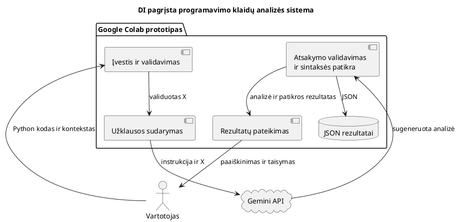
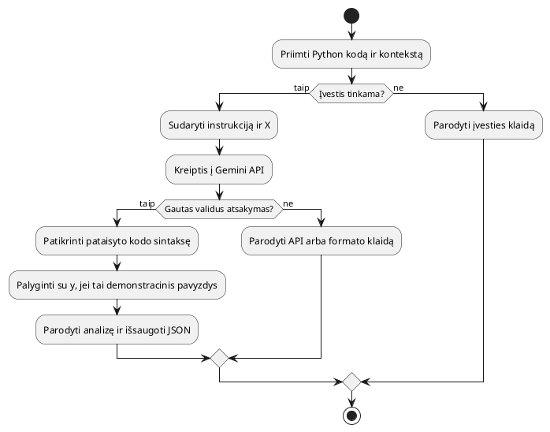
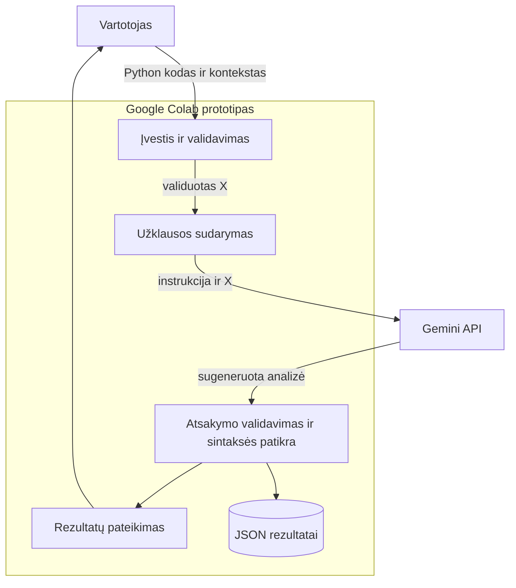
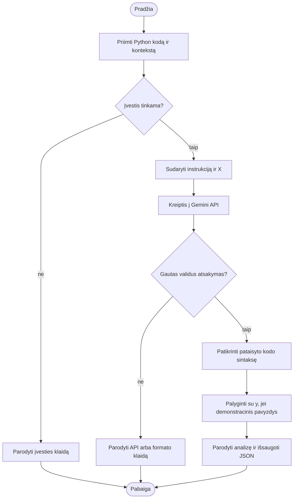

# Sistemos projektas

Pradinė projektavimo užklausa: [design_prompt.txt](../prompts/design_prompt.txt). Pirmiau pateikta PlantUML versija, po jos – tos pačios sistemos Mermaid versija. Tai šiam darbui parengti projektavimo rezultatai.

## 1. PlantUML komponentų diagrama

## 2. PlantUML veiklos diagrama

## 3. Mermaid komponentų diagrama

## 4. Mermaid veiklos diagrama

